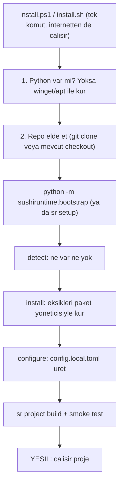
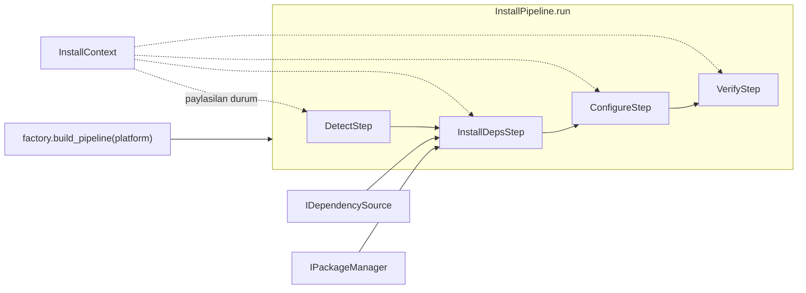

# Tek-Script Installer Tasarımı (Windows + Linux)

Bu doküman bir tasarım planıdır (kod sonra). Sıfır bir makineyi tek komutla
çalışır hale getiren bootstrap + doctor installer'ın mimarisini tanımlar.

## 1. Amaç ve felsefe

Sıfır bir makinede ("adamlarda hiçbir şey yok") tek komutla:

1. Sistem araçlarını kur (python, git, cmake, ninja, derleyici)
2. C++ bağımlılıklarını kur (hwloc, GoogleTest, OpenCL runtime) + opsiyonel CUDA
3. `cli/config.local.toml`'u kurulan araçların GERÇEK yollarıyla otomatik doldur
4. `sr` CLI'ı kur, sonra `sr project build` + smoke test ile doğrula

Anahtar fikir: Bugün elle yapılan iki şey (bağımlılık kurulumu +
`config.local.toml` doldurma) otomatikleşir. Mevcut mimari (config layering,
`env.py` snapshot, `project.py` build) hiç değişmez; installer sadece onların
girdisini hazırlar.

## 2. Mimari: ince bootstrap + kalın Python doctor



Neden iki katman: paket-yöneticisi mantığı platforma özel (winget vs apt) olduğu
ve Python henüz kurulu olmayabileceği için en dış katman shell olmak zorunda.
Geri kalan tüm zeka Python'da (test edilebilir, mevcut `console`/`config`
altyapısını kullanır).

## 3. Yeni dosyalar

- `install.ps1` (repo kökü) - Windows bootstrap. `irm <url> | iex` ile de çalışacak şekilde.
- `install.sh` (repo kökü) - Linux bootstrap. `curl <url> | bash` ile de çalışacak şekilde.
- `cli/dependencies.toml` (yeni) - bağımlılıkların TEK bildirimsel kaynağı. Bkz. Bölüm 3a.
- `cli/sushiruntime/setup/` (yeni paket) - SOLID pipeline. Bkz. Bölüm 3b.
  - `pipeline.py` - `InstallPipeline`, `InstallContext`, `Step` (ABC), `StepResult`.
  - `steps.py` - `DetectStep`, `InstallDepsStep`, `ConfigureStep`, `VerifyStep`.
  - `package_managers.py` - `IPackageManager` + `AptManager`, `WingetManager`, `VcpkgManager`.
  - `dependency_source.py` - `IDependencySource` + `TomlDependencySource` (dependencies.toml okur).
  - `factory.py` - platforma göre pipeline'ı kurar (DI montaj noktası).
- `cli/sushiruntime/services/setup.py` (yeni) - ince servis: CLI'dan çağrılır, factory'den pipeline alıp çalıştırır.
- `cli/sushiruntime/cli.py` - `sr setup` komut grubu eklenir (mevcut Typer yapısına).

## 3a. Bağımlılık yönetimi: tek bildirimsel manifest

Bağımlılık bilgisi koda gömülmez; `cli/dependencies.toml` tek kaynaktır.
`setup.py` bu dosyayı okuyup platforma göre paket listesini toplar. Yeni bir
bağımlılık eklemek = bu dosyaya bir blok eklemek (kodda hiçbir bağımlılık adı
yok).

Kapsam kararı: manifest'i SADECE installer (`setup.py`) okur. `CMakeLists.txt`,
`Dockerfile` ve README'nin "Requirements" listesi (her zamanki gibi) elle
güncellenir; onlar build/dokümantasyon mantığıdır ve manifest'in kapsamı
dışındadır (en az risk).

Örnek `cli/dependencies.toml`:

```toml
[hwloc]
description   = "Hardware locality (topology discovery)"
required      = true
linux_apt     = ["libhwloc-dev"]
windows_vcpkg = ["hwloc"]
check_cmd     = ["pkg-config", "--exists", "hwloc"]   # kurulu mu testi

[gtest]
description   = "GoogleTest"
required      = true
linux_apt     = ["libgtest-dev"]
windows_vcpkg = ["gtest"]

[opencl]
description   = "OpenCL ICD + Intel CPU runtime"
required      = true
linux_apt     = ["ocl-icd-opencl-dev", "ocl-icd-libopencl1"]
windows_vcpkg = []          # vcpkg'de gerekmiyor

[cuda]
description   = "NVIDIA CUDA toolkit (SYCL nvptx backend)"
required      = false
gpu_only      = true        # sadece --gpu ile kurulur
linux_apt     = ["nvidia-cuda-toolkit"]
windows_vcpkg = []
```

Alan sözlüğü:

- `required` - false ise eksikliği build'i durdurmaz (uyarı geçer).
- `gpu_only` - true ise yalnızca `--gpu` bayrağıyla kurulur.
- `linux_apt` / `windows_vcpkg` - platform paket adları; boş liste = o platformda gerekmiyor.
- `check_cmd` - (opsiyonel) bağımlılığın zaten kurulu olup olmadığını test eden komut; idempotency için.

> "Yeni bağımlılık geldiğinde ne yapacağım?" -> `cli/dependencies.toml`'a bir
> blok ekle. Installer tespit + kurulumu otomatik halleder. (Build'e de gerekiyorsa
> `CMakeLists.txt`'i, container'a da gerekiyorsa `Dockerfile`'ı ayrıca güncellersin.)

## 3b. SOLID pipeline mimarisi

Installer tek dev fonksiyon değil; birbirini izleyen bağımsız adımlardan oluşan
bir pipeline'dır. Adımlar ortak bir `InstallContext` üzerinden veri paylaşır,
soyutlamalara bağlıdır (somut araçlara değil) ve dışarıdan enjekte edilir.



### Çekirdek soyutlamalar

```python
# pipeline.py
@dataclass
class InstallContext:
    cfg: Config
    gpu: bool
    dry_run: bool
    detected: dict[str, bool] = field(default_factory=dict)   # DetectStep doldurur
    installed: list[str] = field(default_factory=list)        # InstallDepsStep doldurur
    resolved_paths: dict[str, str] = field(default_factory=dict)  # ConfigureStep doldurur

class StepResult(enum.Enum):
    OK = "ok"; SKIPPED = "skipped"; FAILED = "failed"

class Step(ABC):
    name: str
    @abstractmethod
    def run(self, ctx: InstallContext) -> StepResult: ...

class InstallPipeline:
    def __init__(self, steps: list[Step]): self._steps = steps
    def run(self, ctx: InstallContext) -> bool:
        for step in self._steps:
            result = step.run(ctx)        # her adim ayni sozlesme (Liskov)
            if result is StepResult.FAILED:
                return False              # net hata, dur
        return True
```

### Paket yöneticisi ve bağımlılık kaynağı arayüzleri

```python
# package_managers.py
class IPackageManager(ABC):
    @abstractmethod
    def is_installed(self, pkg: str) -> bool: ...
    @abstractmethod
    def install(self, pkgs: list[str], dry_run: bool) -> bool: ...

class AptManager(IPackageManager): ...      # Linux
class WingetManager(IPackageManager): ...    # Windows toolchain
class VcpkgManager(IPackageManager): ...     # Windows C++ libs

# dependency_source.py
class IDependencySource(ABC):
    @abstractmethod
    def packages_for(self, platform: str, gpu: bool) -> list[str]: ...

class TomlDependencySource(IDependencySource):  # dependencies.toml okur (Bolum 3a)
    ...
```

`InstallDepsStep` somut `apt`/`winget`'i bilmez; yalnızca `IPackageManager` ve
`IDependencySource` arayüzlerine bağımlıdır (Dependency Inversion). Hangi somut
sınıfların kullanılacağına `factory.py` karar verir:

```python
# factory.py
def build_pipeline(cfg: Config, gpu: bool, dry_run: bool) -> tuple[InstallPipeline, InstallContext]:
    source = TomlDependencySource(dependencies_toml_path())
    if cfg.is_windows:
        managers = [WingetManager(), VcpkgManager(cfg)]
    else:
        managers = [AptManager()]
    steps = [
        DetectStep(),
        InstallDepsStep(source, managers, gpu),
        ConfigureStep(),     # config.local.toml uretir
        VerifyStep(),        # sr project build + smoke test
    ]
    return InstallPipeline(steps), InstallContext(cfg=cfg, gpu=gpu, dry_run=dry_run)
```

### SOLID karşılıkları

- **S - Single Responsibility:** Her `Step` tek iş yapar (detect / install / configure / verify). `package_managers.py` sadece paket kurar, `dependency_source.py` sadece manifest okur, `pipeline.py` sadece orkestre eder.
- **O - Open/Closed:** Yeni aşama = yeni `Step` sınıfı + factory listesine ekleme; mevcut adımlara dokunulmaz. Yeni platform = yeni `IPackageManager` impl.
- **L - Liskov:** Tüm `Step`'ler `run(ctx) -> StepResult` sözleşmesine uyar; pipeline hangisi olduğunu bilmeden çağırır. Tüm paket yöneticileri `is_installed/install` ile yer değiştirebilir.
- **I - Interface Segregation:** `Step`, `IPackageManager`, `IDependencySource` ayrı ve küçük; her adım yalnızca ihtiyacı olan arayüze bağımlı.
- **D - Dependency Inversion:** Adımlar soyutlamalara bağlı; somut sınıflar `factory.py`'de enjekte edilir. Test'te sahte (`FakePackageManager`) enjekte edilebilir.

### Test edilebilirlik (DI'ın getirisi)

Her adım izole test edilir: `InstallDepsStep`'e sahte `IPackageManager` +
bellek-içi `IDependencySource` verilip gerçek kurulum yapmadan davranışı
doğrulanır. `--dry-run` tüm adımlardan `InstallContext.dry_run` ile geçer.

## 4. install.ps1 (Windows bootstrap) - sorumluluklar

Saf bootstrap, minimum mantık:

1. Yönetici/PATH kontrolü, `winget` mevcut mu (Win10 19044'te App Installer gerekebilir - kullanıcıya yönlendir).
2. Python yoksa: `winget install Python.Python.3.12`.
3. Repo: zaten checkout içindeyse onu kullan; değilse `git clone`.
4. `python -m pip install ./cli` (veya `install.py`) ile `sr` kur.
5. `python -m sushiruntime.services.setup` veya `sr setup all --gpu:$gpu` çağır.

Çağrı: `powershell -ExecutionPolicy Bypass -File install.ps1 [-Gpu]`

## 5. install.sh (Linux bootstrap) - sorumluluklar

1. `apt` var mı kontrol (yoksa: desteklenmeyen distro mesajı - karar: sadece apt).
2. `sudo apt-get update && apt-get install -y python3 python3-pip git` (eksikse).
3. Repo: checkout veya `git clone`.
4. `python3 -m pip install ./cli`.
5. `sr setup all [--gpu]` çağır.

Çağrı: `bash install.sh [--gpu]`

## 6. Pipeline adımları (asıl iş)

`sr setup` alt komutları: `detect`, `install`, `configure`, `verify`, `all`. Her
biri ilgili `Step`'i (ya da `all` için tüm pipeline'ı) çalıştırır. Adımlar Bölüm
3b'deki `Step` sözleşmesine uyar; aşağıda her birinin davranışı tanımlanır.

### DetectStep - detect()

Mevcut `shutil.which` + sürüm sorgularıyla envanter çıkarır ve `rich` tablo basar
(mevcut `console.py` ile):

- python>=3.10, git, cmake>=3.20, ninja, pkg-config
- Windows: vcpkg, VS BuildTools/vcvars64, oneAPI `icx-cl`
- Linux: SYCL derleyici (`icpx` veya `clang++ -fsycl`), hwloc, GTest, OpenCL ICD
- GPU: `nvidia-smi` var mı (sadece bilgi; `--gpu` olmadan kurulum yapmaz)

### InstallDepsStep - install() - eksikleri kur

C++ kütüphane bağımlılıkları `cli/dependencies.toml`'dan okunur (Bölüm 3a);
aşağıdaki listeler manifest'in tipik içeriğini ve manifest dışında kalan
toolchain adımlarını gösterir.

Windows (`pkg.py` üzerinden):

- winget (toolchain, manifest dışı): `Kitware.CMake`, `Ninja-build.Ninja`, `Git.Git`
- vcpkg: yoksa `C:/vcpkg`'e `git clone` + `bootstrap-vcpkg.bat`, sonra manifest'in `windows_vcpkg` listesini `vcpkg install ... --triplet x64-windows` ile kur (hwloc, gtest, ...).
- VS BuildTools + Intel oneAPI (toolchain, manifest dışı): winget id'leri denenir (`Intel.oneAPI...`); ağır/etkileşimli olanlar için açık komut + link gösterilir ve kullanıcıdan onay alınır (bunlar sessiz kurulamayabilir).

Linux:

- apt: manifest'in `linux_apt` listesini topla + temel toolchain (`build-essential cmake ninja-build git pkg-config`) -> tek `apt-get install -y ...`.
- SYCL (toolchain, manifest dışı): Dockerfile'daki yöntemi taşı - intel/llvm nightly tarball'ı `/opt/intel-llvm`'e indir + PATH/LD_LIBRARY_PATH ayarla; VEYA Intel apt deposundan oneAPI. (Karar: Dockerfile ile uyumlu intel/llvm tarball varsayılan.)
- Intel OpenCL CPU runtime: Dockerfile'daki `intel-oneapi-runtime-opencl` apt deposu adımı.
- `--gpu` ise: manifest'teki `gpu_only = true` bağımlılıklar (CUDA toolkit) - opt-in.

### ConfigureStep - configure() - config.local.toml üret

Kurulan araçların gerçek yollarını bularak `cli/config.local.toml`'u yazar.
Bugün README'de elle doldurulan blok otomatikleşir:

- Windows: `vs_vcvars`, `oneapi_root`, `ninja_exe`, `vcpkg_root`, `icx_compiler`, `pkgconf_exe`
- Linux: intel/llvm kullanılıyorsa `cc/cxx` clang'a düşer (zaten `project.py::_resolve_compiler` bunu yapıyor), `oneapi_root` setvars için.

Yollar `[tool.windows]` / `[tool.linux]` bölüm düzeninde yazılır - mevcut
`config.py::_merge_tool_table` bunu olduğu gibi okur. Var olan dosyayı ezmeden
önce yedek alır.

### VerifyStep - verify()

- `sr project build --type release` (Linux'ta GPU yoksa `--no-cuda`)
- `sr project test --suite functional --filter '...'` ile hızlı smoke test (veya tek binary çalıştır)
- Yeşil/kırmızı özet panel.

### all() - tüm pipeline

`InstallPipeline.run(ctx)` adımları sırayla çalıştırır
(Detect -> InstallDeps -> Configure -> Verify); herhangi biri `FAILED` dönerse
pipeline durur, net hata + sonraki manuel adım önerisi gösterir.

## 7. Mevcut kodla entegrasyon (değişmeyenler)

- `cli/sushiruntime/config.py`: `config.local.toml`'u zaten okuyor - installer sadece onu üretir.
- `cli/sushiruntime/env.py`: vcvars/setvars snapshot mantığı - installer doğru yolları yazınca otomatik çalışır.
- `cli/sushiruntime/services/project.py`: build/test - `verify()` bunu çağırır.
- `Dockerfile`: Linux kurulum adımlarının kanıtlanmış kaynağı; `install()` bunları host'a taşır.

## 8. Hata toleransı / tasarım kararları

- Idempotent: tekrar çalıştırınca kurulu olanları atlar.
- Ağır/etkileşimli kurulumlar (VS BuildTools, oneAPI, CUDA) sessiz kurulamazsa: net komut + resmi link göster, onay iste; tüm script'i patlatma.
- `--dry-run`: ne yapacağını yaz, kurma (güven için).
- Windows yönetici hakkı gerektiren adımlarda erken uyarı.
- README'ye `Quick start (one script)` bölümü eklenir.

## 9. Kararlaştırılan kapsam

- Bağımlılık stratejisi: tam otomatik (derleyici + hwloc + cmake/ninja + opsiyonel CUDA).
- Windows paket kaynağı: winget (sistem araçları) + vcpkg (C++ kütüphaneleri).
- Linux: sadece Debian/Ubuntu (apt).
- GPU/CUDA: `--gpu` bayrağıyla opt-in; varsayılan CPU-only çalışır build.

## 10. Açık varsayımlar

- Linux SYCL için varsayılan: intel/llvm nightly tarball (Dockerfile ile birebir). oneAPI apt alternatifi ikinci seçenek.
- Windows ağır bileşenler (VS BuildTools + oneAPI) tam sessiz kurulamazsa yarı-otomatik (komut göster + onay).
- `vcpkg` kökü Windows'ta `C:/vcpkg` (CMakeLists varsayılanıyla uyumlu); istenirse conda yolu config.local ile override edilebilir.

## 11. Uygulama adımları (todo)

1. `cli/dependencies.toml` - bağımlılıkların tek bildirimsel kaynağı (linux_apt + windows_vcpkg + check_cmd).
2. `setup/pipeline.py` - `Step` (ABC), `StepResult`, `InstallContext`, `InstallPipeline` çekirdek soyutlamaları.
3. `setup/package_managers.py` - `IPackageManager` + `AptManager`/`WingetManager`/`VcpkgManager`.
4. `setup/dependency_source.py` - `IDependencySource` + `TomlDependencySource` (manifest okur).
5. `setup/steps.py` - `DetectStep`, `InstallDepsStep`, `ConfigureStep`, `VerifyStep`.
6. `setup/factory.py` - platforma göre pipeline'ı DI ile kur.
7. `services/setup.py` + `cli.py` - `sr setup` komut grubunu Typer'a bağla (detect/install/configure/verify/all).
8. `install.ps1` - python/git bootstrap + sr kur + `sr setup all` çağır (irm|iex uyumlu).
9. `install.sh` - apt ile python/git bootstrap + sr kur + `sr setup all` çağır (curl|bash uyumlu).
10. README'ye "Quick start (one script)" bölümü ekle.
